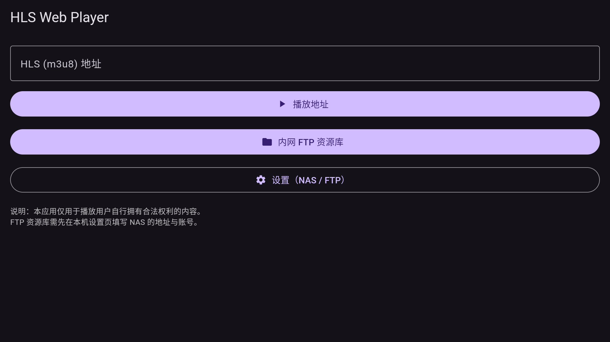
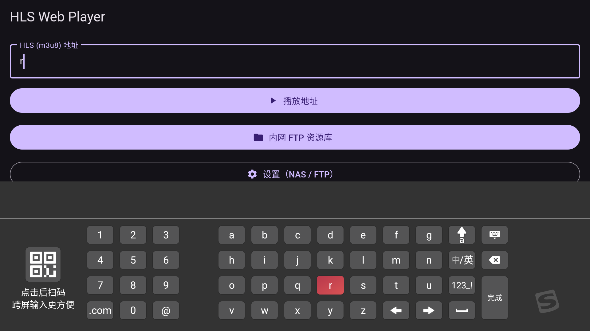
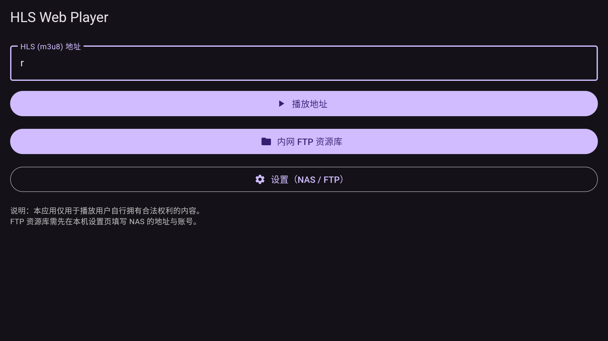
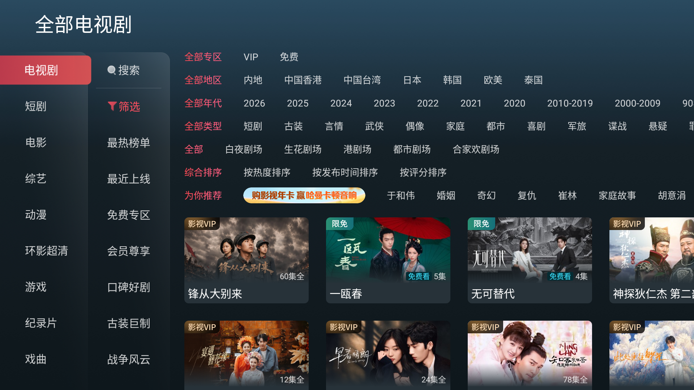
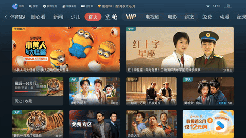
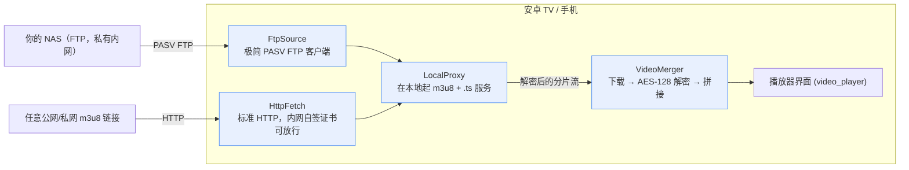

# hls_proxy_player

[](https://github.com/dominic717/hls_proxy_player/actions)
[](LICENSE)
[](https://flutter.dev)

一个**零媒体服务器**的安卓 TV 私有 NAS 播放方案 + 可复用的 Flutter 库。

核心思路：用一个**本地代理**把你的 NAS 内容（FTP 上的 HLS 分片）以标准 `m3u8` 的形式喂给播放器，
**边下载、边 AES-128 解密、边拼接**，全程在设备本地完成——你不需要装 Plex / Jellyfin / Emby 这类媒体服务器。

这个仓库包含两部分：

- 📦 **`hls_proxy_player`** —— 可复用的库（本仓库根目录的 `lib/`）
- 📺 **`example/`** —— 一个可以直接打包的**安卓 TV 私有 NAS 播放器** App，消费上面的库

👉 如果你的 m3u8 不是来自 NAS，而是**从某个你有权限的播放页里解析出来的**，用配套的 [**`hls_rulegen`**](https://github.com/dominic717/hls_rulegen) 把它抽出来，再把地址交给本库的 `LocalProxy` 播——两个仓库是**一对互补的"自托管 HLS 工具箱"**：`hls_rulegen` 负责"**从哪来**"（解析出 m3u8），本库负责"**怎么播**"。详见下方「配合 hls_rulegen 使用」。

---

## 这东西是给谁用的？（先说清楚定位）

你家里有台 NAS，存着自己的一些视频（已经是 HLS 分片，或者能提供 `m3u8`）。
你想在安卓电视上看，但**不想安装、也不想维护一个媒体服务器**。

这个项目就是为这个场景做的"零配置播放器"：用 FTP 指一下你的 NAS（或者直接贴任意 `m3u8` 链接）就能播，
所有解密、拼接都在电视本地完成。

**郑重说明**：它**不是**抓取/盗版工具，只播放**你自己提供**的内容。

---

## 为啥不直接用 Plex / Jellyfin / Emby？

因为它们是**媒体服务器**——你得装一个、指一下文件目录、管媒体库、处理转码、搞端口映射，有些还要月费。
软件很好，但对你那个单一需求（"NAS 上有视频，我想在电视上看"）来说太重了。

本项目直接跳过服务器：

| | hls_proxy_player | Plex / Jellyfin |
|---|---|---|
| 需要媒体服务器 | 不需要 | 需要 |
| 配置 | 填 FTP 地址 + 一个 `_map.txt`（或者自动扫描） | 安装 + 配一个媒体库 |
| 数据去哪 | 始终留在你内网 | 服务器会索引你的文件 |
| 占用 | 电视上一个 APK | 一个常驻服务 |
| 最适合 | "就把我 NAS 上的视频播到电视上" | 大媒体库 + 远程串流 |

想要完整媒体中心就用 Plex；想要"NAS 文件夹 → 电视屏幕"最短路径、不搭任何服务器，就用这个。

---

## 截图

| 首页 | 设置（NAS / FTP） | FTP 媒体库 | 播放器 |
|------|------------------|-----------|--------|
|  |  |  |  |



---

## 整体架构



库（`lib/`）就是上图绿色那一块——每个组件都能单独拿去复用：

| 文件 | 干啥的 |
|------|--------|
| `local_proxy.dart` | 本地 HTTP 代理，把 NAS/FTP 内容暴露成标准 m3u8 |
| `merger.dart` | 下载分片、边下边 AES-128 解密、拼成一个清晰的流 |
| `ftp_source.dart` | 极简 PASV FTP 客户端 + NAS 目录解析（`_map.txt`） |
| `http_fetch.dart` | 标准 HTTP 抓取；**仅在内网网段**放行自签证书 |
| `crypto_util.dart` | AES-128-CBC 工具（密钥走标准 `#EXT-X-KEY`） |
| `policy.dart` / `priority.dart` | 可调的运行期策略常量 / 任务优先级队列 |
| `dbg.dart` | 可选的调试日志助手 |

---

## 合规性

本项目**只**用于播放你拥有合法访问权的自有内容。代码里**不含**以下任何一项：

- 任何特定站点域名、UA/Referer 伪造、TLS 指纹伪造（比如 Cronet 反爬栈）；
- 基于 DoH 的 IP 轮换或其他反爬 / 反封锁手段；
- 从第三方站点扒出来的静态解密密钥；
- 源码里硬编码的 NAS 凭据——配置放在本地 `local_config.json`，**永不提交**（见 `.gitignore`）。

AES-128 解密遵循 HLS 规范（密钥随 `#EXT-X-KEY` 一起下发），不内置任何第三方静态密钥。

---

## 快速上手

### 在自己的 App 里用这个库

```yaml
# pubspec.yaml
dependencies:
  hls_proxy_player:
    path: ../hls_proxy_player   # 发布后换成 pub.dev 的链接
```

```dart
import 'package:hls_proxy_player/hls_proxy_player.dart';

final proxy = LocalProxy();
await proxy.start();                 // 在 http://127.0.0.1:<端口> 上提供服务
// 把 proxy.playlistUrl / 分片地址交给你的 video_player 控制器即可
```

### 运行 / 打包示例安卓 TV App

```bash
cd example
flutter pub get
# 安卓 TV（32 位 armeabi-v7a，很多 VIDAA / 老安卓电视都是这个）
# 注意 IS_TV=true：隐藏首页网址输入框，只留 FTP 媒体库 + 设置
flutter build apk --target-platform android-arm --release --flavor tv --dart-define=IS_TV=true
# 手机（arm64）
flutter build apk --target-platform android-arm64 --release --flavor phone --dart-define=IS_TV=false

adb install -r build/app/outputs/flutter-apk/app-tv-release.apk
```

在电视 App 里（全程遥控器操作，**不需要打字**）：

1. **设置** → 填你的 NAS/FTP 连接（主机、端口、用户名、密码、根目录）。**只需填这一次，存在电视本机**。
2. 回到首页，打开 **FTP 媒体库** → 电视上直接铺开你 NAS 里所有剧的卡片墙，
   用**方向键移动**、**OK 键**播放，全程不输入任何网址。
   （NAS 上需要一个 `_map.txt` 索引；没有也能自动扫描目录，见 `docs/nas-setup.md`）
3. 进入播放后用方向键**选集**、调倍速、全屏、续播。

> 注：首页那个"贴 m3u8 网址播放"的输入框，是给**手机/电脑端**随手贴链接用的；
> **电视版 APK（构建时传 `IS_TV=true`）已直接隐藏它**，用遥控器打字太反人类。看电视只看第 2 步的媒体库即可。

---

## 配合 hls_rulegen 使用（从播放页获得 m3u8）

如果你的 m3u8 **不是**来自 NAS/FTP，而是藏在某个你**有权限**的播放页里，可以用配套的
[**`hls_rulegen`**](https://github.com/dominic717/hls_rulegen) 把它解析出来，再交给本库的 `LocalProxy` 播。
两个仓库是上下游关系：

```
你的播放页 HTML
   │  hls_rulegen: 用规则抽出 m3u8 地址 (extractM3u8)
   ▼
某个上游 m3u8 链接
   │  hls_proxy_player: 本地代理把分片/AES-128 密钥重写到 127.0.0.1
   ▼
本地 m3u8 地址  ──►  video_player 播放
```

```dart
// 1) hls_rulegen：从播放页抽出 m3u8（仅限你有权限的站点）
import 'package:hls_rulegen/parser.dart';
final urls = extractM3u8(pageHtml, url: pageUrl, templates: myTemplates);
final upstream = urls.first;

// 2) hls_proxy_player：起本地代理，把上游 m3u8 改写成可播放的本地地址
import 'package:hls_proxy_player/hls_proxy_player.dart';
final proxy = LocalProxy.instance;
await proxy.start();
final playUrl = proxy.m3u8Url(upstream); // http://127.0.0.1:<port>/m3u8/index.m3u8?u=<编码后的上游地址>

// 3) 交给播放器
videoController = VideoPlayerController.network(playUrl);
```

> 两库的合规边界一致：只处理你**合法拥有 / 有权限**的内容。`hls_rulegen` 内置的是通用抽取引擎（不含任何真实站点规则），本库的 `LocalProxy` 只做标准 HLS 的 AES-128 解密（密钥随 `#EXT-X-KEY` 下发），无任何绕过/伪造类逻辑。

**示例 App 已内置这个入口**：首页（手机/桌面端，非电视）新增一个「播放页地址（自动解析 m3u8）」输入框 + 「解析并播放」按钮——粘贴播放页 URL，App 抓取源码、用 `hls_rulegen` 抽出 m3u8、再经本库 `LocalProxy` 播放。电视端因遥控器打字不便，仍只保留 FTP 媒体库与设置。

---

## 目录结构

```
.
├── lib/                 # 📦 hls_proxy_player 库（可复用的核心）
│   ├── hls_proxy_player.dart   # 统一导出
│   ├── local_proxy.dart
│   ├── merger.dart
│   ├── ftp_source.dart
│   ├── http_fetch.dart
│   ├── crypto_util.dart
│   ├── policy.dart
│   ├── priority.dart
│   └── dbg.dart
├── example/             # 📺 安卓 TV 私有 NAS 播放器 App（库的消费者）
│   ├── lib/
│   ├── android/
│   └── pubspec.yaml
├── LICENSE              # MIT
└── pubspec.yaml         # 库的包清单
```

---

## 许可证

[MIT](LICENSE)

---

<details>
<summary>English summary</summary>

A **zero-media-server** Android TV private NAS player plus a reusable Flutter library.

It plays your own NAS (FTP) HLS content through a **local proxy** that decrypts AES-128
segments and merges them on the fly — no Plex / Jellyfin / Emby. The `local_proxy` + `merger`
logic is also extracted into the reusable `hls_proxy_player` package. The repo is for playing
content you legally own; it contains no site-scraping, private-key extraction, WAF bypass, or
hard-coded credentials.

</details>
