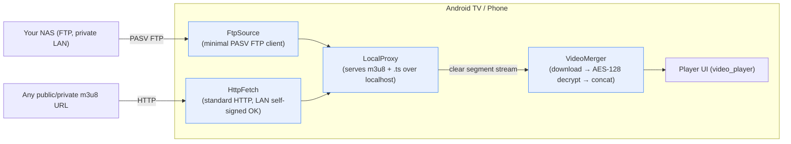

# hls_proxy_player

A small, self-contained **Flutter toolkit** for playing HLS (`m3u8`) streams through a
**local proxy** that decrypts AES-128 segments and merges them on the fly — plus a minimal
PASV **FTP transport** so you can stream your *own* NAS content without ever running a media
server (no Plex / Jellyfin / Emby).

It ships as:

- 📦 **`hls_proxy_player`** — the reusable library (this repo root `lib/`)
- 📺 **`example/`** — a ready-to-build **Android TV NAS player** app that consumes the library

---

## Who is this for? (the niche)

You have a NAS at home with your own video files (already split into HLS segments, or served
as m3u8). You want to watch them on an Android TV **without installing or maintaining a media
server**. This project is a ~zero-config player: point it at your NAS over FTP (or paste any
m3u8 URL) and it plays — the decryption/merging all happens locally on the device.

It is deliberately **not** a scraping/piracy tool: it plays content *you* provide.

---

## Architecture



The library (`lib/`) is the green box — every component is reusable on its own:

| File | Responsibility |
|------|----------------|
| `local_proxy.dart` | Local HTTP proxy that exposes NAS/FTP content as a standard m3u8 |
| `merger.dart` | Downloads segments, decrypts AES-128 on the fly, concatenates to one clear stream |
| `ftp_source.dart` | Minimal PASV FTP client + NAS directory parsing (`_map.txt`) |
| `http_fetch.dart` | Standard HTTP fetcher; accepts self-signed certs **only on private LAN ranges** |
| `crypto_util.dart` | AES-128-CBC helpers (keys delivered via standard `#EXT-X-KEY`) |
| `policy.dart` / `priority.dart` | Tunable runtime policy constants / task priority queue |
| `dbg.dart` | Optional debug logging helper |

---

## Compliance

This project is built **only** to play content you have the legal right to access. The code
contains **none** of the following:

- Any specific site domain, UA/Referer spoofing, or TLS-fingerprint forgery (e.g. Cronet anti-blocking stacks);
- DoH-based IP-rotation or other anti-crawl / anti-block techniques;
- Static decryption keys extracted from third-party sites;
- Hard-coded NAS credentials in source — config lives in a local `local_config.json` that is
  **never committed** (see `.gitignore`).

AES-128 decryption follows the HLS spec (`#EXT-X-KEY` delivered alongside the content); no
third-party static key is bundled.

---

## Getting started

### Use the library in your own app

```yaml
# pubspec.yaml
dependencies:
  hls_proxy_player:
    path: ../hls_proxy_player   # or the pub.dev URL once published
```

```dart
import 'package:hls_proxy_player/hls_proxy_player.dart';

final proxy = LocalProxy();
await proxy.start();                 // serves on http://127.0.0.1:<port>
// hand proxy.playlistUrl / segment URLs to your video_player controller
```

### Run / build the example Android TV app

```bash
cd example
flutter pub get
# Android TV (32-bit armeabi-v7a, e.g. many VIDAA / older Android TVs)
flutter build apk --target-platform android-arm --release --flavor tv
# Phone
flutter build apk --target-platform android-arm64 --release --flavor phone

adb install -r build/app/outputs/flutter-apk/app-tv-release.apk
```

In the app:

1. **Settings** → fill in your NAS/FTP connection (host, port, user, password, root dir).
2. Home: paste an `m3u8` URL to play directly, or open **FTP Library** to browse your NAS
   (requires a `_map.txt` index on the NAS).
3. Player supports episode switching, speed, fullscreen and resume.

---

## Project layout

```
.
├── lib/                 # 📦 hls_proxy_player library (the reusable kernel)
│   ├── hls_proxy_player.dart   # barrel export
│   ├── local_proxy.dart
│   ├── merger.dart
│   ├── ftp_source.dart
│   ├── http_fetch.dart
│   ├── crypto_util.dart
│   ├── policy.dart
│   ├── priority.dart
│   └── dbg.dart
├── example/             # 📺 Android TV NAS player app (consumer of the library)
│   ├── lib/
│   ├── android/
│   └── pubspec.yaml
├── LICENSE              # MIT
└── pubspec.yaml         # library package manifest
```

---

## License

[MIT](LICENSE)
